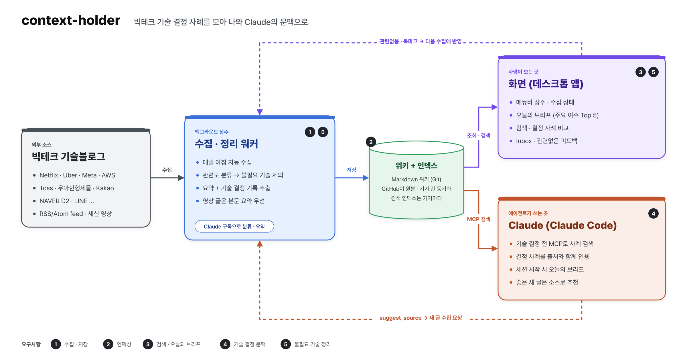

# context-holder

빅테크 기술블로그의 기술 결정 사례를 모아, 나와 AI 코딩 에이전트의 문맥으로 쓰는 개인용 도구.

## 무엇을 하나

- **수집 · 정리 워커**: 백그라운드에서 매일 빅테크 기술블로그를 수집한다. 고른 직군과 무관한 글은 걸러 내고, 요약과 기술 결정 기록(문제 · 선택지 · 결정 · 트레이드오프)을 만들어 위키에 저장한다. 요약과 분류는 설정에서 고른 [에이전트](#에이전트)가 한다.
- **화면**: 메뉴바에 상주하는 데스크톱 앱이다. 오늘의 브리프, 검색, 회사별 결정 사례 비교를 보여 주고, 관련없는 글은 피드백으로 정리한다.
- **위키 검색**: 에이전트에게 기술 선택을 물으면 이 위키의 사례를 찾아 답한다.

## 시작하기

준비물:

- macOS
- GitHub 계정
- [지원 에이전트](#에이전트) 중 하나의 구독

git과 Python은 앱에 들어 있어 따로 설치할 필요가 없다.

[GitHub Releases](https://github.com/yogurt-c/context-holder/releases)에서 최신 `.dmg`를 내려받아 설치한다.

앱을 처음 실행하면 **Onboarding** 탭이 열린다. 왼쪽에 5단계가 있고, 단계를 누르면 오른쪽에 그 단계의 할 일이 나온다. 처음에는 지금 할 단계가 열려 있고, 끝나면 다음 단계로 넘어간다.

1. **GitHub 연결** — 브라우저에서 승인하면 위키 레포(`context-wiki`, private)를 찾거나 새로 만든다.
2. **에이전트 연결** — 요약 · 분류에 쓸 에이전트를 고르고 로그인한다.
3. **수집 설정** — 수집할 직군과 수집 시각을 고르고 완료를 누르면 첫 수집이 시작된다. 직군은 나중에 설정에서 바꿀 수 있다.
4. **첫 수집** — 수집이 끝나면 Today·Search·Inbox를 쓸 수 있다.
5. **주제 정리** — 첫 수집이 끝날 때 결정 사례를 주제별로 묶는다. 그 뒤로는 매일 수집이 끝날 때 새 사례를 묶는다. 잘못 묶인 사례는 Decisions에서 옮기거나 주제를 고친다.

다 끝나면 Onboarding 탭은 사라진다. 다른 기기에서도 같은 순서로 설치하면 같은 위키를 쓴다.

## 에이전트

| 에이전트   | 필요한 구독          | 명령줄 도구      |
| ------ | --------------- | ----------- |
| Claude | Pro / Max       | Claude Code |
| Codex  | ChatGPT Plus 이상 | Codex CLI   |

- **요약 · 분류**: 매일 수집(분류 · 요약 · 주제 묶기)을 맡을 에이전트를 설정에서 고른다.
- **계정**: 터미널 로그인을 그대로 쓰거나, 앱에서 계정을 추가해 바꿔 쓸 수 있다.
- **위키 검색**: 연결해 두면 에이전트가 답하기 전에 이 위키를 찾아본다.

## 수집 대상 블로그

기준: **엔지니어링 결정 사례가 꾸준히 나오는 곳.** 어떤 글을 남길지는 Onboarding · 설정에서 고른 **직군**으로 정한다.

| 직군 | 수집하는 글 | 기본 선택 |
| --- | --- | --- |
| 백엔드 | 서버 아키텍처, DB · 캐시 · 메시징, 대규모 트래픽, 장애 분석, 검색 · 추천 서빙, 인증 · 인가 | ✅ |
| 프론트엔드 · 모바일 | 웹 성능 · 렌더링, 상태 관리, 빌드, iOS · Android 아키텍처, 앱 성능 · 릴리스, 클라이언트 보안 | ✅ |
| AI 엔지니어링 | 만들어진 모델을 쓰는 일: LLM 비용 · 서빙, 에이전트 · MCP · 하네스, 컨텍스트 설계, 프롬프트 인젝션 방어 | ✅ |
| ML | 모델을 만드는 일: 모델 설계 · 학습, ML 플랫폼, 추천 · 검색 모델과 효과 측정 | |
| 인프라 · DevOps | 클라우드 · 쿠버네티스, 네트워크, SRE, 인프라 비용, IAM · 제로트러스트 | ✅ |
| 데이터 엔지니어링 | 데이터 파이프라인, 스트리밍, 웨어하우스, 데이터 품질 · 접근 제어 | ✅ |
| 보안 | 위협 모델링, 탐지 · 대응, 침투 테스트, 암호화, 취약점 분석 · CVE 대응 | |

- 테스트 · CI/CD · 관측성 같은 개발 생산성 글은 직군과 상관없이 모은다.
- 고르지 않은 직군에만 해당하는 글은 거른다. 고른 직군 기준에도 맞으면 남긴다.
- 직군을 바꾸면 다음 수집부터 적용된다. 이미 모은 글은 바뀌거나 지워지지 않고, 같은 위키를 쓰는 모든 기기에 함께 적용된다.

직군별 기준은 [`roles.yaml`](engine/src/context_holder/defaults/roles.yaml), 상세 기준은 [계획 5.1](docs/plan.md#51-관련도-기준) 참고.

### 늘 수집

| 구분  | 회사             | feed                                              | 수집 방식                 |
| --- | -------------- | ------------------------------------------------- | --------------------- |
| 국내  | NAVER D2       | `https://d2.naver.com/d2.atom`                    | feed 전문 · 세션 영상 글 포함  |
| 국내  | Toss           | `https://toss.tech/rss.xml`                       | feed 전문               |
| 국내  | 우아한형제들         | `https://techblog.woowahan.com/feed/`             | feed 전문               |
| 국내  | LINE (LY Corp) | `https://techblog.lycorp.co.jp/ko/feed/index.xml` | feed + 본문 요청          |
| 국내  | 당근             | `https://medium.com/feed/daangn`                  | feed 전문               |
| 국내  | 올리브영           | `https://oliveyoung.tech/rss.xml`                 | feed + 본문 요청          |
| 국내  | 무신사            | `https://medium.com/feed/musinsa-tech`            | feed 전문               |
| 국내  | Kakao          | `https://tech.kakao.com/feed/`                    | feed + 본문 요청          |
| 국내  | NHN Cloud      | `https://meetup.nhncloud.com/rss`                 | feed 전문               |
| 해외  | Netflix        | `https://netflixtechblog.com/feed`                | feed 전문               |
| 해외  | GitHub         | `https://github.blog/engineering/feed/`           | feed 전문               |
| 해외  | Cloudflare     | `https://blog.cloudflare.com/rss/`                | feed 전문               |
| 해외  | Airbnb         | `https://medium.com/feed/airbnb-engineering`      | feed 전문               |

해외 4곳은 대규모 트래픽 · 인프라 결정 사례를 보강하려고 넣었다.

### 직군을 골랐을 때만 수집

| 직군 | 회사 | feed | 수집 방식 |
| --- | --- | --- | --- |
| ML | Meta | `https://engineering.fb.com/feed/` | feed 전문 |
| ML | Pinterest | `https://medium.com/feed/pinterest-engineering` | feed 전문 |
| ML | Google Research | `https://research.google/blog/rss/` | feed + 본문 요청 |
| ML | Spotify | `https://engineering.atspotify.com/feed/` | feed + 본문 요청 |
| 프론트엔드 · 모바일 | Shopify | `https://shopify.engineering/blog.atom` | feed + 본문 요청 |
| 프론트엔드 · 모바일 | Grab | `https://engineering.grab.com/feed.xml` | feed 전문 |
| 보안 | Trail of Bits | `https://blog.trailofbits.com/feed/` | feed 전문 |
| 보안 | GitHub Security | `https://github.blog/security/feed/` | feed 전문 |

새로 만드는 위키에만 들어간다. 이미 있는 위키의 `config/sources.yaml`은 그대로 둔다.

### 제외

| 회사                                      | 이유                          |
| --------------------------------------- | --------------------------- |
| 하이퍼커넥트 · Slack                          | 최근 새 글 없음                   |
| 쿠팡                                      | 오랫동안 새 글 없음                 |
| 뱅크샐러드                                   | 최근 글이 디자인 위주                |
| AWS Architecture · Google Cloud         | 고객 사례 · 제품 소개 위주            |
| Lyft · Dropbox                          | 글이 적고 BE · FE 비중 낮음         |
| Android Developers · Google Security    | 플랫폼 발표 위주 · 2026-04 이후 새 글 없음 |
| Uber · DoorDash                         | feed 요청을 막음                   |
| Stripe · Discord · Spotify · Shopify    | feed에 요약만 있고 회사 소식 글 비중이 높음 |
| Uber · LinkedIn · DoorDash · 컬리 · 카카오페이 | feed 주소를 찾지 못했거나 자동 요청 차단   |

실제 수집 설정은 위키 레포의 `config/sources.yaml`에서 관리한다.

## 문서

- [계획](docs/plan.md)
- [메뉴바 앱](app/README.md) · [엔진](engine/README.md)
- [상세 아키텍처](docs/architecture/architecture.png)
- [화면 시안](docs/ui/screens/) · [디자인 시스템](docs/ui/screens/design-system.png)